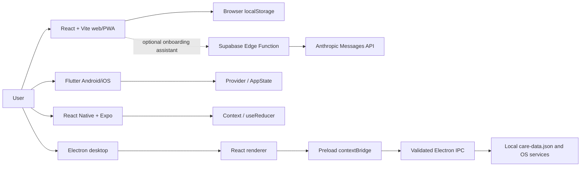

# CareConnect — Developer Guide

This guide covers the four implementations in the monorepo. Each app has its own dependencies, test commands, release process, and maturity. No platform should be treated as a secure clinical product: authentication and data are demonstration/local implementations.

## Architecture overview



The web assistant is the only documented remote API integration. The Flutter and React Native builds use app-local demonstration state. Electron keeps operating-system/file-system access in the main process and exposes a narrow preload bridge to its sandboxed React renderer.

## Repository map

```text
web/                  React + TypeScript + Vite responsive web app
mobile-flutter/       Flutter app for Android/iOS
mobile-rn/            React Native + Expo app for Android/iOS
desktop-electron/     Electron main/preload + React renderer
docs/week6/           mobile accessibility and Maestro evidence
docs/week8/           Electron architecture, tests, and accessibility
docs/week9/           Electron accessibility fixes and desktop VPAT
docs/week12/          final user/developer guides and Week 12 VPATs
```

### Platform internals

| Platform | Main modules | State and persistence |
|---|---|---|
| Web | `web/src/pages/`, `components/`, `shell/`, `auth/`, `data/`, `web/src/App.tsx` | React context and browser `localStorage`; demo/mock authentication. |
| Flutter | `mobile-flutter/lib/main.dart`, `models/app_state.dart`, `screens/`, `widgets/`, `theme/` | One `AppState` `ChangeNotifier` exposed through Provider; named routes and sample seed data. |
| React Native | `mobile-rn/src/navigation/`, `state/`, `screens/`, `components/`, `theme/` | Context + `useReducer`; React Navigation native stack and bottom tabs. |
| Electron | `desktop-electron/electron/` and `src/` | Sandboxed renderer, typed preload bridge, sender-validated IPC, local JSON care-plan store, native menus/tray/dialogs. See [ARCHITECTURE.md](../week8/ARCHITECTURE.md). |

## Prerequisites

- Git and Node.js. Use Node 22 for Electron/Expo; the web project's Vite scripts run with a supported Node version.
- Flutter SDK 3.27+ and Dart 3.6+ for Flutter.
- Android Studio/Android SDK for Android builds. Xcode and macOS are required to build/run iOS targets.
- On Linux headless systems, `xvfb-run` is needed for Electron Playwright tests.
- Expo Go or a configured native development environment for React Native previews. An EAS account/profile is needed only if producing EAS builds.

## Setup and common workflows

Clone and enter the repository:

```bash
git clone https://github.com/LaoWai-Fi/careconnect-swen661-T1.git
cd careconnect-swen661-T1
```

### Web (React)

```bash
cd web
npm ci
cp .env.example .env       # optional; keep secrets out of source control
npm run dev
npm run build
npm run preview
npm run lint
npm run typecheck
npm run screenshots
```

`npm run` is the authoritative list of scripts. The current checked-in `web/package.json` does **not** define `test`, `test:e2e`, or `lighthouse:accessibility`; the supplied Week 12 Part 1 report records tests/audits run on its fix branch. Do not present those commands as reproducible from this checkout until the test scripts and dependencies are checked in.

The optional onboarding assistant calls `POST {VITE_SUPABASE_URL}/functions/v1/chat-assistant` with `{ "messages": [{ "role": "user" | "assistant", "content": "..." }] }`. The Edge Function returns `{ "reply": "..." }` or `{ "useFallback": true }`; malformed requests return a 400. Store `ANTHROPIC_API_KEY` as a Supabase server-side secret, never in a `VITE_` variable. The client uses the public Supabase URL/anon key and falls back to scripted replies on API errors. The assistant is not a medical-advice service.

### Flutter

```bash
cd mobile-flutter
flutter pub get
flutter run
flutter test
flutter test --coverage
flutter test integration_test
```

To target a device explicitly, use `flutter devices` then `flutter run -d <device-id>`. Android/iOS build output and signing configuration are platform-specific; no app-store deployment is configured in the repository.

### React Native / Expo

```bash
cd mobile-rn
npm ci
npx expo start
npm test -- --runInBand
npm run coverage -- --runInBand
npm run lint
```

Use the Expo terminal prompts for a configured Android/iOS device. The checked-in `app.json` identifies native platforms; the repository does not contain an `eas.json` release profile, so configure and verify a profile before describing EAS APK/IPA output as available.

### Electron desktop

```bash
cd desktop-electron
npm ci
npm start
npm run typecheck
npm run lint
npm test -- --runInBand
npm run test:coverage -- --runInBand
npm run test:e2e
```

For separate Vite/Electron development, run `npm run dev`, then in a second terminal set `CARECONNECT_DEV_URL=http://127.0.0.1:5173` and run `npm run desktop`. On headless Linux: `xvfb-run -a npm run test:e2e`.

## Testing and accessibility evidence

| Platform | Automated commands / evidence | Important scope limit |
|---|---|---|
| Web | Current package scripts: build, lint, typecheck, screenshot capture. The supplied Part 1 report records 135 Jest/RTL tests, 455 Playwright passes, and 24/24 route/mode Lighthouse accessibility scores of 100 on the fix-branch production build. | WAVE and axe DevTools results in that report are local production-build runs, not live-site scans. Current `web/package.json` lacks the report's test scripts. VoiceOver/Safari did not speak the appointment-delete status. |
| Flutter | `flutter test --coverage`, `flutter test integration_test`; `test/accessibility/accessibility_guidelines_test.dart` checks Flutter tap-target and labeled-target guidelines. | Week 6 report records Android TalkBack walkthroughs, but no iOS VoiceOver result. Automated widget checks do not prove complete WCAG conformance. |
| React Native | `npm test`; `npm run coverage`; `npm run lint`. RNTL checks roles, labels, state, forms, and workflows. | Week 6 records Android TalkBack; iOS VoiceOver is not recorded. |
| Electron | `npm test`, `npm run test:coverage`, `npm run test:e2e`, `npm run typecheck`, `npm run lint`; detailed counts in [TEST_REPORT.md](../week8/TEST_REPORT.md). | Manual keyboard and VoiceOver evidence is macOS-specific. NVDA, Windows contrast themes, and native Windows/Linux assistive behavior remain unverified. |

Current/reported historical test counts are not guarantees for a newly changed checkout. Re-run the commands that exist in the exact final branch, retain the output, and date/version the submitted evidence.

## Deployment and distribution

| Platform | Build/deploy path | Current limitation |
|---|---|---|
| Web | `cd web && npm ci && npm run build`; publish `web/dist`. The currently recorded public site is [GitHub Pages](https://laowai-fi.github.io/careconnect-swen661-T1/). | The repository's checked-in workflows list only the Electron workflow. Confirm the GitHub Pages deployment settings/action in the target repository before changing deployment configuration. Optional assistant requires a deployed Supabase Edge Function and server-side secret. |
| Flutter | Use `flutter build apk` / `flutter build appbundle` for Android or `flutter build ipa` on macOS/Xcode for iOS, with correct signing and environment-specific configuration. | No store listing, production signing setup, or release automation is documented. Week 6 APKs were delivered separately, not tracked in Git. |
| React Native | Expo development preview via `npx expo start`; native run via `npx expo run:android` / `npx expo run:ios` where configured. EAS build requires a configured profile. | No `eas.json`, store configuration, or current public mobile release is recorded. Do not imply the old Week 6 builds are current releases. |
| Electron | `npm run dist:mac:intel`, `npm run dist:mac:arm`, `npm run dist:win`, or `npm run dist:linux`; CI workflow builds macOS and Windows artifacts after tests. | Builds are unsigned/not notarized. macOS/Linux distribution requires the appropriate host or CI. Auto-update requires a published GitHub Release and signing is not configured. |

## Configuration and data safety

- Root and platform `.gitignore` files exclude `.env`; keep the optional Anthropic secret server-side.
- Web uses mock authentication and browser-local demo data; the Supabase assistant is an optional onboarding integration, not the care-plan database.
- Flutter and React Native use demonstration state. No cross-platform sync or production server is documented.
- Electron stores the sample care plan in the OS user-data directory and supports import/export. Treat its JSON file as unencrypted local demo data.
- Never test with real patient data, credentials, or protected health information.

## Documentation and traceability

- [User guide](USER_GUIDE.md)
- [Week 12 submission index and remaining checks](README.md)
- [Mobile VPAT](MOBILE_VPAT.md)
- [Desktop VPAT](../week9/CARECONNECT_DESKTOP_VPAT.md)
- [Web VPAT](WEB_VPAT.md)
- [Web accessibility implementation notes](../../web/ACCESSIBILITY.md)
- [Desktop architecture and security notes](../week8/ARCHITECTURE.md)
